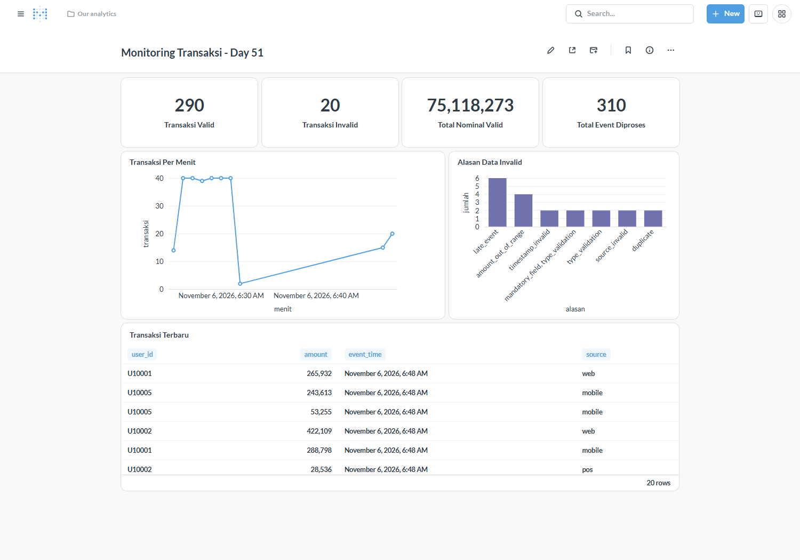

# Streaming Data Pipeline - Day 51

Project simulasi transaksi menggunakan Python, Kafka, dan Spark Streaming. Data valid dan invalid dipisahkan, lalu hasilnya disimpan di PostgreSQL dan ditampilkan di Metabase.

## Alur

Producer -> Kafka (transactions) -> Spark Streaming

- Valid -> transactions_valid
- Invalid -> transactions_dlq
- Hasil transaksi -> PostgreSQL -> Dashboard Metabase

## Yang dikerjakan

- Producer mengirim JSON setiap 1,5 detik.
- Validasi field wajib, tipe data, amount, source, dan duplikat.
- Simulasi 3 late event, watermark 3 menit.
- Window transaksi 1 menit.
- Output timestamp dan running_total di console.
- Dashboard untuk melihat hasil transaksi.

## Hasil

Bukti ada di folder evidence: screenshot producer, streaming, dashboard, dan contoh data CSV.

## Cara menjalankan

1. Jalankan Docker Desktop.
2. Salin .env.example menjadi .env, lalu isi password.
3. Jalankan dari folder project:

    docker compose up -d --build

4. Lihat log:

    docker compose logs -f producer

    docker compose logs -f streaming

5. Setelah Metabase siap, buat dashboard:

    python dashboard/setup_dashboard.py

6. Buka http://localhost:23380/dashboard/1

Untuk berhenti: docker compose down.

## Port

- Kafka: 23292
- Spark UI: 23240
- PostgreSQL: 23332
- Metabase: 23380

Data transaksi dalam project ini adalah data simulasi.
